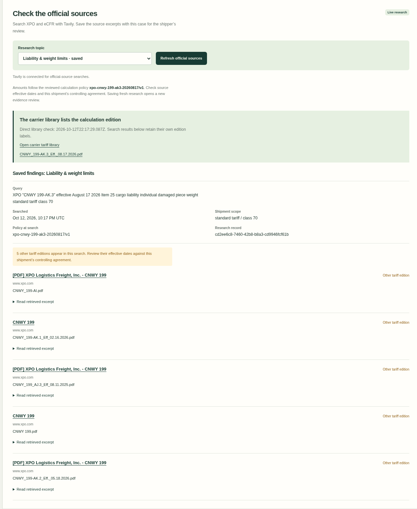

# Version-aware official-source research

DockProof uses Tavily to find the rule evidence a shipper needs to review alongside a claim. Its three topics cover liability/weight, filing requirements, and invoice discounts. The selected service and freight class refine the liability query.

## A real integration finding

On 13 October 2026, two live Basic searches returned five other CNWY tariff editions. One older PDF’s retrieved excerpt described a **$150,000** shipment maximum. A direct read of [XPO’s tariff library](https://www.xpo.com/tariff-library/) listed **CNWY 199-AK.3, effective August 17, 2026**. DockProof’s reviewed policy uses that edition’s **$100,000** maximum.

The product shows the library check first and labels each search result’s relationship to the calculation edition. Other-edition excerpts have an explicit expansion control. The shipper checks effective dates and the shipment’s controlling agreement; the fixed policy continues to compute money.

## Reproduce

1. Open [live evaluation](https://blucca.github.io/dockproof/judge/) with the supplied judge code, or configure your own local Tavily account using the README.
2. In a sample or personal claim, choose **Rules & scope → Liability & weight limits → Search official sources**.
3. Inspect the query, selected terms, retrieval timestamp, direct carrier-library check and individual source editions. The live index can return a different selection over time.
4. Review the updated evidence snapshot and download the claim packet. `05-rule-research.json` contains the searches and library observations; `review.html` includes the readable appendix. Each topic keeps its latest result set in this case.

## Implementation

- `src/tavily.mjs`: native Fetch, Basic Search, account allowance check, persistent one-credit reservation, official URL filtering and direct tariff-library comparison.
- `src/server.mjs`: authenticated, same-origin `/api/rules` with the shared live-request slot.
- `web/app.mjs`: query controls, browser-local records, version labels and asynchronous case lock.
- `web/core/case-engine.mjs`: research participates in the review fingerprint and the exported appendix. Monetary policy remains versioned independently.

Public research uses rule topics and selected service/class. The search payload excludes shipment identifiers, document text and claim amounts. Provider keys stay on the server.

The focused checks cover reservation before HTTP, provider failure retention, allowance exhaustion, query validation, official URL filtering, case review reopening and the exported appendix. A real Chromium workflow also covered the live lookup, refresh, original-case lock, failed-search preservation and a 390 px layout. All shipment records in that demonstration are synthetic.
