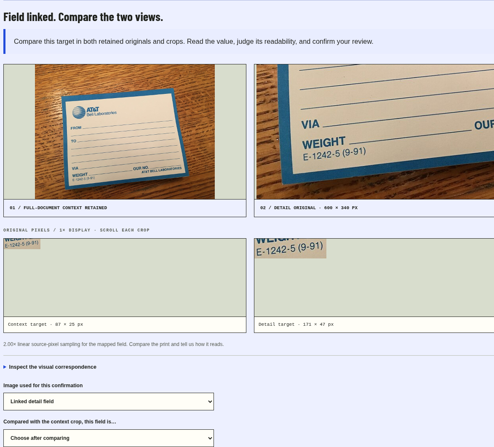

# Keep the full label. Get a closer field.

A full-label photo carries context. A closer photo supplies a larger view of a small field. Capture Loop now retains both originals, maps the selected field between them, and records a separate field reading linked to both sources.

**[Try the two-view sample →](https://blucca.github.io/research/capture-loop/)**

1. Choose **Start the two-view sample**. The station saves the full label and selects its printed form code.
2. Check the same-document declaration and choose **Load the paired sample detail**.
3. Compare both originals and their 1× source-pixel crops. Enter the code you read, assess whether it is easier to read, and save the confirmation.

For your own document, start with all four page edges, select the field, then photograph it more closely with surrounding words or distinctive marks. The full-label context remains saved while the detail-photo loop progresses.



The supplied Bell Labs example uses **one natural photograph with controlled scaling and cropping**. Its context is the 640 px version of the existing Wikimedia thumbnail; its detail is a 600 × 340 original-pixel crop of the 1280 px thumbnail. The sampled field grows from **87 × 25 to 171 × 47 pixels**, with **2.00× linear sampling** from the mapped quadrilateral area. The label's printed code is `E-1242-5 (9-91)`.

## What the image tool checks

[`detail.py`](../../detail.py) uses SIFT features, bidirectional Lowe-ratio matching and a RANSAC homography. It maps the context field into the detail's original coordinate system and checks geometric consensus, match distribution, support near the field and complete target coverage. An accepted crop is a lossless PNG slice of the retained detail pixels, preserving orientation.

| Development parameter | Value |
|---|---:|
| Working image / features | Long edge ≤1600 px, ≤1.6 MP, ≤2400 SIFT features per image |
| Mutual Lowe ratio / RANSAC threshold | 0.75 / 3 working pixels |
| Consensus | ≥12 inliers and distinct locations; ≥40% inlier ratio |
| Bidirectional reprojection | Median ≤1.5 px; P95 ≤3 px |
| Target support | ≥6 nearby distinct inliers; ≥50% target coverage by the inlier hull |
| Detail-review sampling threshold | ≥1.2× linear / ≥1.44× mapped field area |
| Retained field crop | ≤3 MP; exact decoded source slice → PNG |

The full threshold set and per-case observations are in [`pair-results.json`](pair-results.json). These are development settings for flat printed pages with shared visible features. **Sampling ratios describe the uploaded raster.** The same-document declaration and the reviewer's reading establish the intended item and the visible value; the readability assessment records their comparison. Focus and contrast remain per-image diagnostics.

## Selected cases

| Pair | Visual correspondence | Linear sampling | Saved next step |
|---|---|---:|---|
| Bell 640 px → controlled detail | 106 / 113 inliers; complete target | 1.99935× | Open separate detail review |
| Bell 640 px → identical raster | Accepted; complete target | 1.00000× | Request a closer detail; retain mapped crop |
| Bell → crop omitting the target | Accepted global mapping; field outside frame | 2.00611× | Request the complete target |
| Bell → unrelated GLS parcel | 7 mutual matches | — | Request shared field context |
| SmartDoc frame 22 → frame 72 | 488 / 502 inliers; complete target | 0.94277× | Request a closer detail; retain mapped crop |

The natural control uses **two distinct handheld frames of the same physical A4 sheet**, taken with a Google Nexus 7 according to the dataset authors. `Power Dissipation: 300 mW` is visible in both. Frame 72 changes perspective and provides a smaller sampled field. This exercises natural registration and a further-detail request. [Source, frame indices and selected field coordinates](natural-pair-source.json).

Sampling units: one Bell Labs photograph, one unrelated GLS photograph and one SmartDoc video. Independent phone retakes and participant field readings are collected through the external trial. The recorded confirmations here use scripted reviewers.

## Agent and evidence trail

The existing AWS image tool measures the full-label context. The detail tool runs OpenCV 5 registration on the station server. The live model calls `inspect_field_detail`, then executes `request_detail_recapture` or `prepare_detail_review`. The executable review contract checks the accepted field and sampling threshold. The next detail receives the preceding request.

A [recorded native-tool run](../../evidence/detail-native-session.json) keeps one AWS-measured context, tries an intentionally unrelated control photo, then supplies the controlled matching detail. The model requests shared context for the unrelated photo and opens review for the matching field. It uses **six successful model HTTP calls, one AWS image call and two local detail registrations**, followed by a separately scripted confirmation. [Run summary](../../evidence/detail-native-acceptance.json).

`POST /api/detail` accepts the image body and query fields `captureId`, `fieldInspectionId`, `sameDocument=true`, `name` and, for a further detail, `replacesDetail`. Each detail uses the existing photo allowance. The result is appended under its saved field inspection. The full context, previous details and previous review records stay in the same session. A detail review stores both original identifiers, both source regions and the reviewer's `easier` / `same` / `harder` assessment. Session isolation, expiry and deletion cover the whole pair.

[Algorithm checks](../../evidence/detail-algorithm-acceptance.json) verify source-pixel equality and the selected mapping cases. [Browser check](../../evidence/detail-browser-acceptance.json) covers the clickable sample, fresh confirmation, required readability choice, reload and 390 px layout. The focused HTTP contract covers context retention, attempt counting, stale-detail handling, separate source binding, session access and deletion.

## Reproduce

Use the experiment's pinned Python / OpenCV 5 environment. From the repository root:

```sh
python -B experiments/capture-loop/docs/field-pair/replay-pair.py --output ../../temp/capture-pair-replay
python -B experiments/capture-loop/tests/test_detail.py
python -B experiments/capture-loop/tests/test_hosted.py HostedContracts.test_linked_detail_retains_context_and_binds_separate_review
node --test experiments/capture-loop/tests/detail-contract.test.mjs
```

The replay writes generated crops and JSON to the selected temporary directory. The natural context frame is already bundled in `fixtures/`; [frame 72](datasheet001-frame-0072.png) was decoded sequentially from the same official video. The provided [manifest](manifest.json) fixes the controlled sample, source transforms and field selection.

## Image credits

- **Bell Labs photograph and controlled views:** Jonathan Schilling, [AT&T Bell Laboratories package mailing labels](https://commons.wikimedia.org/wiki/File:AT%26T_Bell_Laboratories_package_mailing_labels.jpg), [CC BY-SA 4.0](https://creativecommons.org/licenses/by-sa/4.0/). The detail PNG, Bell crops and `detail-*.png` interface screenshots retain this license. [Thumbnail, original metadata and earlier scale study](../field-source-scale/).
- **GLS rejection control:** Klaus Mueller, [Kleines paket.JPG](https://commons.wikimedia.org/wiki/File:Kleines_paket.JPG), CC BY-SA 3.0; [existing attribution](../../domain/ATTRIBUTION.md).
- **Natural handheld frames and their crops:** SmartDoc 2015 authors, [official sample dataset](https://zenodo.org/records/1230218), [CC BY 4.0](https://creativecommons.org/licenses/by/4.0/). [Full attribution and frame provenance](natural-pair-source.json).
- Code: repository MIT license. These sources and the scripted workflow support the selected development examples above.
