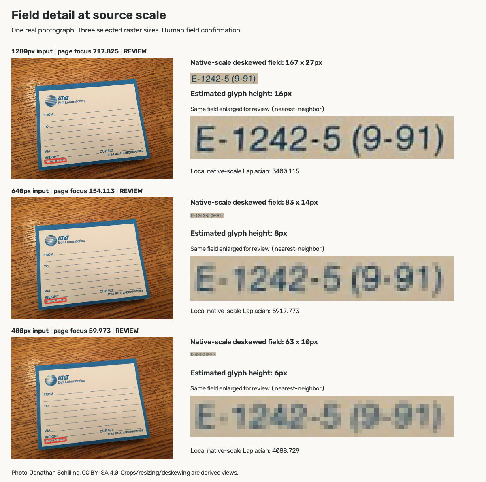

# Field detail at source scale

A whole-page capture can reach the review stage while a small target field occupies very few source pixels. This selected development probe measures that situation using a photographed Bell Labs mailing label and two controlled lower-resolution versions.



## Result

The target is the bottom-left printed form code **E-1242-5 (9-91)**.

| Image width | Whole-page Laplacian | Capture action | Native-scale field size | Estimated glyph height | Local native-scale Laplacian |
|---:|---:|---|---:|---:|---:|
| 1280 px | 717.825 | `prepare_document_review` | 167 × 27 px | 16 px | 3400.115 |
| 640 px | 154.113 | `prepare_document_review` | 83 × 14 px | 8 px | 5917.773 |
| 480 px | 59.973 | `prepare_document_review` | 63 × 10 px | 6 px | 4088.729 |

All three retain four interior page corners and reach document review. The 480-pixel image provides a 6-pixel median candidate glyph height for the selected code. The enlarged crops make the remaining sampled detail visible to the reviewer.

**Field confirmation needs the selected source region.** A useful interface presents a native-pixel crop, links its coordinates to the original capture, and records the text the reviewer checked. A request for a closer field photo can retain the full-document capture as context.

The local Laplacian rises from 3400.115 to 5917.773 as image width falls from 1280 to 640 pixels. Its interpretation depends on character scale, contrast and resampling. The existing threshold **50** applies to `capture.py`'s **1000-pixel-wide, page-normalized measurement**. The local native-scale numbers in this report are diagnostics. Human confirmation supplies the checked field value.

## Source and transformations

- **Photograph:** [AT&T Bell Laboratories package mailing labels](https://commons.wikimedia.org/wiki/File:AT%26T_Bell_Laboratories_package_mailing_labels.jpg), Jonathan Schilling, 2020-01-17.
- **License:** [CC BY-SA 4.0](https://creativecommons.org/licenses/by-sa/4.0/). This directory's derived photographs preserve that license and attribution.
- **Original:** [4032 × 3024 JPEG](https://upload.wikimedia.org/wikipedia/commons/8/8b/AT%26T_Bell_Laboratories_package_mailing_labels.jpg). The downloaded original's selected EXIF fields record Apple iPhone 6s, 1/30 s, f/2.2, ISO 100. [Metadata record](source-original-metadata.json).
- **Probe input:** the existing [official Wikimedia 1280 × 960 JPEG thumbnail](https://thumb.wikimedia.org/wikipedia/commons/thumb/8/8b/AT%26T_Bell_Laboratories_package_mailing_labels.jpg/1280px-AT%26T_Bell_Laboratories_package_mailing_labels.jpg).
- **1280 output:** decoded source at unchanged dimensions, saved as PNG.
- **640 and 480 outputs:** each resized directly from that 1280 thumbnail with OpenCV `INTER_AREA`, then saved as PNG. These two degradation steps introduce area resampling and lossless output encoding. JPEG processing belongs to the preceding source/thumbnail chain.
- **Comparison views:** outlined source photos, source bounding-box crops, native-footprint perspective deskew, and nearest-neighbor display enlargement.

The sampling unit is **one natural photograph at three selected raster sizes**. This probe reports measured geometry, source-pixel scale and inspectable image detail. Independent participant photos and blind field-transcription outcomes belong to the external trial.

## Field coordinates and measurement

The hand-selected quadrilateral in the 1280-pixel thumbnail is:

```json
[[263,810],[429,792],[432,819],[266,837]]
```

For each input width, multiply coordinates by `width / 1280`. The native-scale output width is the rounded top-edge length; its height is the rounded left-edge length. OpenCV `getPerspectiveTransform` and `warpPerspective` with default linear interpolation deskew into that footprint. Raw source bounding-box crops are also included for direct pixel inspection.

For estimated character size, convert the native-scale crop to grayscale, apply inverted Otsu thresholding, and measure connected components. Retain component area ≥2 pixels, component width <13% of crop width, and component height from 30% inclusive to 97% exclusive of crop height. Report the median retained height. This selected printed-line heuristic identifies candidate glyph bodies; the JSON retains each candidate height. The ROI, size convention and component filter are fixed across the three chosen resolutions.

## Reproduce

Run from the repository root using the capture loop's pinned OpenCV 5 / NumPy environment:

```sh
python -B experiments/capture-loop/docs/field-source-scale/field-probe.py --output ../../temp/capture-field-probe
```

`--capture-dir` defaults to `experiments/capture-loop`. Set it explicitly when running from another working directory. The source image and its attribution are read from the existing domain fixtures. `--output` selects the workspace temporary directory for all generated inputs, crops, perspective views, comparison panel and JSON.

[Full machine-readable results](field-study.json) include the executed page measurements, field coordinates, native sizes, glyph candidates, local diagnostics, source attribution and transformations. [Reproduction script](field-probe.py).
